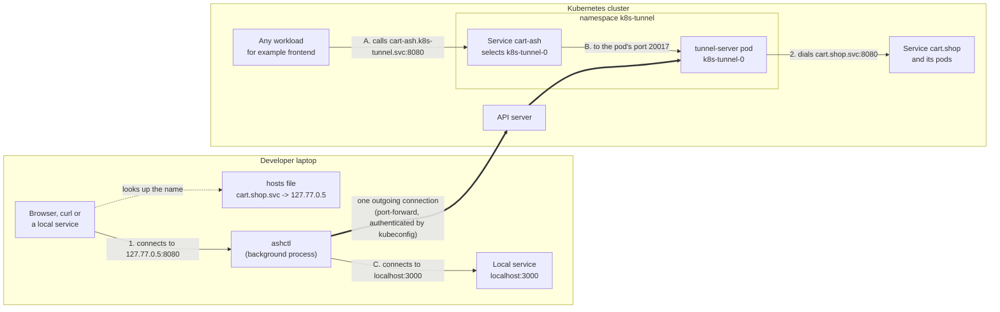
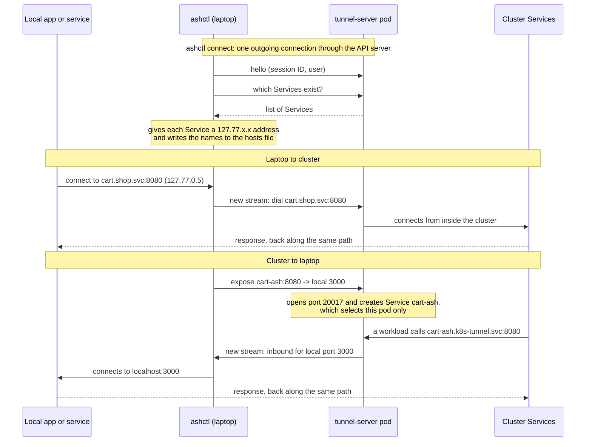

# k8s-tunnel

Run one service on your laptop as if it were inside the cluster.

- **Inbound:** each exposed local port gets a Service in the cluster that points at the tunnel server, which relays connections to the local service. Routing to that Service (for example by a routing-key header in Istio) is up to the mesh.
- **Outbound:** connections from the laptop are sent through the tunnel and dialled from inside the cluster.

One shared server serves all users and can run as several replicas. Works with any cluster reachable through your kubeconfig (EKS, AKS, GKE).

## Status

Working: the tunnel server, the client library, and the `ashctl` client, which connects in the background, exposes local ports, forwards single addresses, and makes cluster Service names resolve locally.

Not built yet: several connections at once, and the terminal dashboard.

## How it works

The laptop makes one outgoing connection to a tunnel server pod, through the Kubernetes API server (a port-forward). Traffic in both directions travels over that one connection, so nothing ever connects inward to the laptop.



The thick arrows are the tunnel. Steps 1 and 2 are the laptop reaching a cluster Service; steps A to C are a cluster workload reaching a service on the laptop.



## Usage

```bash
ashctl connect --context dev
```

That connects to the cluster and returns. The connection keeps running in the background, independent of the terminal, and reconnects by itself if it drops.

| Command | What it does |
|---|---|
| `ashctl connect [--context NAME]` | Connect and keep running in the background |
| `ashctl expose NAME:PORT[:LOCALPORT][/PROTOCOL]` | Make a local port reachable in the cluster, on the running connection |
| `ashctl unexpose NAME` | Stop exposing it |
| `ashctl generate` | Write a commented `ashctl.yaml` to fill in |
| `ashctl apply` | Connect if needed and expose what `ashctl.yaml` lists |
| `ashctl status` | Show whether you are connected, and what is exposed |
| `ashctl disconnect` | Stop the connection and remove its Services and hosts entries |
| `ashctl logs` | Show the background connection's output |
| `ashctl cleanup` | Remove hosts-file entries left behind by a crash |

One connection runs at a time.

### Exposing a local service

Once connected, expose and unexpose as often as you like, with no reconnecting:

```bash
ashctl expose b-ash:8080:3000/http
```

That creates the Service `b-ash` in the tunnel namespace. Anything in the cluster that connects to `b-ash.k8s-tunnel.svc:8080` reaches `localhost:3000` on your machine.

The argument is not a URL. It is four pieces of information:

```
b-ash : 8080 : 3000 / http
  │      │      │      │
  │      │      │      └─ protocol the service speaks
  │      │      └──────── port your service listens on, on your machine
  │      └─────────────── port the cluster uses to call it
  └────────────────────── name of the Service created in the cluster
```

| Piece | Meaning | Notes |
|---|---|---|
| Name | The Service name. Callers reach it at `NAME.k8s-tunnel.svc`. | Your choice; any name not already in use. `<service>-<user>` keeps names unique and shows whose they are. |
| Cluster port | The port callers in the cluster connect to. | Normally the port the real service uses. |
| Local port | Where your service listens on your machine. | Leave it out when it equals the cluster port: `b-ash:8080`. |
| Protocol | `http` or `grpc`. Tells the mesh what the port carries, which header-based routing needs. | Leave it out for plain TCP such as a database. |

```bash
ashctl unexpose b-ash
```

Several can be given at once, and specs with the same name become one Service with several ports. Exposing a name again replaces it. Exposures come back by themselves after a reconnect and are all removed on disconnect.

Exposing creates an address; it does not move any traffic. The real service keeps receiving everything it did before. Something else decides which requests go to your copy:

- a routing rule in the service mesh, for example "requests carrying this routing key go to `b-ash.k8s-tunnel.svc`";
- or a caller configured to use your address, as the demo below does;
- or, for a quick check, calling the address directly from a pod.

`connect` also accepts `--expose` to start with some already in place, and `--forward LOCALPORT:HOST:PORT` to reach one cluster address on a local port when names do not resolve (see below). Add `--foreground` to stay attached to the terminal instead, until Ctrl-C.

### Keeping it in a file

Typing the same `expose` arguments every day gets old, and a team should not have to pass port numbers around. Describe what a project needs in an `ashctl.yaml`, kept in the project's repository:

```bash
ashctl generate
```

That writes an `ashctl.yaml` in the current folder with every field explained and shown with an example, all commented out. Remove the `#` from what you need:

```yaml
context: dev
homeNamespace: shop
expose:
  - name: cart-${USER}
    port: 8080
    localPort: 3000
    protocol: http
```

Then, in that folder:

```bash
ashctl apply
```

- If you are not connected, it connects using the file and exposes everything in it.
- If you are connected, it changes the running connection to match: it exposes what is missing, replaces what changed, and leaves the rest untouched. Run it again whenever you edit the file.
- `${USER}` in a name is replaced by your user name, so everyone sharing the file gets their own Service and nobody collides.
- Things you exposed by hand with `ashctl expose` are left alone. `ashctl apply --prune` also removes everything the file does not list.
- `ashctl apply -f other.yaml` uses another file; `ashctl generate -o other.yaml` writes one. `generate` never overwrites an existing file unless given `--force`.

| Field | Meaning |
|---|---|
| `context` | Cluster to connect to, as named in your kubeconfig. Default: your current context. |
| `homeNamespace` | Namespace whose Services also resolve by bare name. |
| `hostsNamespaces` | Only resolve Services in these namespaces. Default: all. |
| `expose` | List of `name`, `port`, optional `localPort` and `protocol`, as for `ashctl expose`. |
| `forward` | List of `localPort` and `target` (`HOST:PORT`), for when names do not resolve. |
| `namespace` | Namespace the tunnel server runs in. Default `k8s-tunnel`. |

`context`, `homeNamespace`, `hostsNamespaces`, `forward` and `namespace` are used when connecting. Changing them needs `ashctl disconnect` followed by `ashctl apply`; `apply` says so when it applies. A misspelt field name is reported as an error, not ignored.

### Cluster names on your machine

When `ashctl connect` is run from a terminal started as administrator (Windows) or with `sudo` (Linux), every cluster Service name works locally with its own port. A service whose configuration holds addresses like `cart.shop.svc.cluster.local:8080` then runs unchanged, and no `--forward` is needed.

This needs elevation because it edits the hosts file. Without elevation `ashctl` still connects, says that names will not resolve, and `--expose` and `--forward` work as usual. Use `--hosts` to make that an error instead, or `--no-hosts` to never touch the hosts file.

How it works:

- The client asks the tunnel server which Services exist, and refreshes that every 30 seconds.
- Each Service gets its own loopback address (`127.77.0.1` upwards). The client listens there on the Service's ports and sends connections through the tunnel.
- The hosts file gets one line per Service mapping `name.namespace`, `name.namespace.svc` and `name.namespace.svc.cluster.local` to that address. With `--home-namespace`, Services in that namespace also resolve by bare name.
- Every line it writes ends in `# k8s-tunnel`. Nothing else in the file is touched, and the lines are removed on disconnect.

If the background process is killed before it can clean up, remove the leftover lines with:

```bash
ashctl cleanup
```

Limits: TCP only; names resolve only for Services (not individual pods); a new Service takes up to 30 seconds to appear; macOS is not supported yet because it needs each loopback address added to the interface first. A name of the form `name.namespace` can shadow a real internet host when the namespace is also a top-level domain, for example a Service `web` in namespace `dev` shadows `web.dev`. Use `--hosts-namespaces` to limit which namespaces are resolved.

### Flags of `ashctl connect`

| Flag | Meaning |
|---|---|
| `--context`, `--kubeconfig` | Which cluster to use. Defaults to your current kubectl context. |
| `--expose NAME:PORT[:LOCALPORT][/PROTOCOL]` | Expose a local port. Repeat it for more ports; specs with the same name become one multi-port Service. The protocol (`http`, `grpc`, ...) is set as the Service port's `appProtocol`, which the mesh needs for header-based routing. |
| `--forward LOCALPORT:HOST:PORT` | Reach a cluster address on a local port. Repeatable. Listens on loopback only. |
| `--foreground` | Stay attached to the terminal instead of running in the background. |
| `--hosts` | Require cluster names to resolve locally; fail if the hosts file cannot be changed. |
| `--no-hosts` | Never touch the hosts file. |
| `--hosts-namespaces a,b` | Only resolve Services in these namespaces. Default: all. |
| `--home-namespace NS` | Services in this namespace also resolve by bare name. |
| `--cluster-domain` | The cluster's DNS suffix. Default `cluster.local`. |
| `--hosts-file` | Hosts file to manage. Defaults to the system one. |
| `--namespace` | Namespace the tunnel server runs in. Default `k8s-tunnel`. |
| `--selector` | Label selector for the server pods. Default `app.kubernetes.io/name=k8s-tunnel`. |
| `--port` | Server port inside the pod. Default 7000. |
| `--user` | Name recorded on your Services. Defaults to your OS user name. |
| `--session` | Session id. Reuse one to reclaim your Services after restarting the client. |
| `--server HOST:PORT` | Connect straight to a server, skipping the cluster. For local testing. |

The background connection keeps its state and log in `%AppData%\ashctl` on Windows and `~/.config/ashctl` on Linux.

## Try it without a cluster

Start the server with Service publishing turned off:

```bash
./bin/tunnel-server -publish=false -listen 127.0.0.1:7000
```

In another terminal, connect to it directly:

```bash
./bin/ashctl connect --foreground --no-hosts --server 127.0.0.1:7000 --expose b-ash:8080:3000 --forward 8081:example.com:80
```

The client prints the server port chosen for the exposure. Connecting to that port on localhost reaches `localhost:3000`, which is what a Service would do in a cluster.

## Demo

A ten-minute walkthrough on a local cluster, with a two-service application: a web page that asks a `color-api` for a colour and paints its background with it.

```
                    cluster                                    your machine
  ┌──────────────────────────────────────────────┐
  │  frontend ─────────────► color-api  (red)    │
  │                                              │
  │  frontend-preview ─► color-api-dev ─► tunnel ─┼──────► color-api (blue)
  └──────────────────────────────────────────────┘           localhost:8081
```

- `frontend` is the application as it normally runs. It calls the cluster's `color-api`, which answers red.
- `frontend-preview` is the same frontend, set up to call `color-api-dev` in the tunnel namespace. That Service only exists while you expose it, and it leads to your machine. It stands in for a routing-key rule in a service mesh.

The point of the demo: the cluster keeps showing red, your own copy shows blue, and one command decides whether the cluster can reach your copy.

The steps are the same on every system. They are written out for Windows first; the [Linux commands](#on-linux) follow.

### On Windows

PowerShell, with Docker Desktop's Kubernetes.

#### Set up (once)

1. Build the client and server:

   ```powershell
   go build -o bin\ ./cmd/...
   ```

2. Install the tunnel server into the local cluster. This builds the server image, loads it into the cluster nodes and installs the chart:

   ```powershell
   powershell -ExecutionPolicy Bypass -File deploy\local\deploy.ps1
   ```

3. Install the demo application and wait until all three pods are `1/1 Running`:

   ```powershell
   kubectl apply -f deploy\demo\demo.yaml
   ```

   ```powershell
   kubectl get pods -n default
   ```

4. Start your own copy of the API on your machine and leave it running. It prints a line for every request it receives:

   ```powershell
   docker run --rm -p 8081:8080 -e BG_COLOR=blue ashutosh5786/color-api:blue
   ```

   The colour comes from `BG_COLOR`, not from the image tag. Any CSS colour works, for example `green`.

#### Walkthrough

Use a terminal started with **Run as administrator**, so that cluster names resolve on your machine.

1. **Before connecting, the cluster is out of reach.** Open this in a browser; it does not load, because the name only exists inside the cluster:

   ```
   http://frontend.default.svc.cluster.local:8080
   ```

2. **Connect.** The command returns once connected and keeps running in the background:

   ```powershell
   .\bin\ashctl.exe connect --context docker-desktop
   ```

   ```
   connected to k8s-tunnel-0 as you (session s89e6abfdca3f74c4)
   resolving 7 cluster services by name

   Running in the background (process 33720). Use "ashctl status" and "ashctl disconnect".
   ```

3. **Reload the page. It is red.** Same address, no port-forward. Frontend and API both run in the cluster. The API can be called directly too:

   ```powershell
   curl.exe http://color-api.default.svc.cluster.local:8080/color
   ```

   ```
   {"color":"red"}
   ```

4. **Open the preview frontend. It has no colour yet.** It stays on "loading...", because the Service it calls does not exist:

   ```
   http://frontend-preview.default.svc.cluster.local:8080
   ```

5. **Expose your machine.**

   ```powershell
   .\bin\ashctl.exe expose color-api-dev:8080:8081/http
   ```

   ```
   exposed   color-api-dev.k8s-tunnel.svc:8080 -> localhost:8081
   ```

6. **Press Refresh on the preview page. It turns blue,** and the container from set-up step 4 prints a request line. A pod in the cluster has just called your machine.

7. **Press Refresh on the first page. It is still red.** The real service is untouched; only callers sent to your copy reach you.

8. **See what was added to the cluster:** one Service, pointing at the tunnel.

   ```powershell
   kubectl get svc -n k8s-tunnel
   ```

9. **Take it away.** The Service is removed and the preview page goes back to "loading...":

   ```powershell
   .\bin\ashctl.exe unexpose color-api-dev
   ```

10. **Disconnect.** Cluster names stop resolving and nothing is left behind:

    ```powershell
    .\bin\ashctl.exe disconnect
    ```

Without an administrator terminal, names do not resolve. Reach the two frontends through local ports instead, at `http://localhost:9000` and `http://localhost:9001`:

```powershell
.\bin\ashctl.exe connect --context docker-desktop --forward 9000:frontend.default.svc:8080 --forward 9001:frontend-preview.default.svc:8080
```

#### Clean up

```powershell
.\bin\ashctl.exe disconnect
```

```powershell
kubectl delete -f deploy\demo\demo.yaml
```

### On Linux

Bash, with a local [kind](https://kind.sigs.k8s.io/) cluster. The steps and what you should see are the same as on Windows; only the commands differ.

Two things are specific to Linux:

- **Use `sudo` for every `ashctl` command.** Making cluster names resolve means editing `/etc/hosts`, which needs root. The background connection then belongs to root, so `expose`, `status` and `disconnect` need `sudo` as well to find it.
- **Tell `connect` where your kubeconfig is.** Under `sudo` it would otherwise look in root's home directory.

#### Set up (once)

1. Build the client and server:

   ```bash
   go build -o bin/ ./cmd/...
   ```

2. Install the tunnel server into the local cluster. This builds the server image, loads it into the cluster nodes and installs the chart:

   ```bash
   bash deploy/local/deploy.sh
   ```

3. Install the demo application and wait until all three pods are `1/1 Running`:

   ```bash
   kubectl apply -f deploy/demo/demo.yaml
   ```

   ```bash
   kubectl get pods -n default
   ```

   The demo images are built for arm64. On an arm64 machine they run as they are. On x86-64 they need emulation, which Docker Desktop includes and plain Docker Engine does not; install it once with:

   ```bash
   docker run --privileged --rm tonistiigi/binfmt --install arm64
   ```

4. Start your own copy of the API on your machine and leave it running:

   ```bash
   docker run --rm -p 8081:8080 -e BG_COLOR=blue ashutosh5786/color-api:blue
   ```

#### Walkthrough

1. **Before connecting, the cluster is out of reach.** This fails, because the name only exists inside the cluster:

   ```bash
   curl http://frontend.default.svc.cluster.local:8080
   ```

2. **Connect.** With kind the context is usually `kind-kind`; `kubectl config get-contexts` lists yours:

   ```bash
   sudo ./bin/ashctl connect --context kind-kind --kubeconfig "$HOME/.kube/config" --user "$USER"
   ```

3. **The cluster's own version is red.** Open `http://frontend.default.svc.cluster.local:8080` in a browser, or ask the API:

   ```bash
   curl http://color-api.default.svc.cluster.local:8080/color
   ```

   ```
   {"color":"red"}
   ```

4. **The preview frontend has no colour yet.** `http://frontend-preview.default.svc.cluster.local:8080` stays on "loading...". Its API call fails:

   ```bash
   curl -i http://frontend-preview.default.svc.cluster.local:8080/api/color
   ```

5. **Expose your machine.**

   ```bash
   sudo ./bin/ashctl expose color-api-dev:8080:8081/http
   ```

6. **The preview is now blue,** served from your machine. Press Refresh on the preview page, or:

   ```bash
   curl http://frontend-preview.default.svc.cluster.local:8080/api/color
   ```

   ```
   {"color":"blue"}
   ```

   The container from set-up step 4 prints a line for the request.

7. **The normal frontend is still red.**

   ```bash
   curl http://frontend.default.svc.cluster.local:8080/api/color
   ```

8. **See what was added to the cluster:** one Service, pointing at the tunnel.

   ```bash
   kubectl get svc -n k8s-tunnel
   ```

9. **Take it away.**

   ```bash
   sudo ./bin/ashctl unexpose color-api-dev
   ```

10. **Disconnect.** Cluster names stop resolving and `/etc/hosts` is back as it was:

    ```bash
    sudo ./bin/ashctl disconnect
    ```

Without `sudo`, names do not resolve. Drop `sudo`, `--kubeconfig` and `--user` from every command and reach the two frontends through local ports instead, at `http://localhost:9000` and `http://localhost:9001`:

```bash
./bin/ashctl connect --context kind-kind --forward 9000:frontend.default.svc:8080 --forward 9001:frontend-preview.default.svc:8080
```

#### Clean up

```bash
sudo ./bin/ashctl disconnect
```

```bash
kubectl delete -f deploy/demo/demo.yaml
```

### If something goes wrong

| What you see | Cause and fix |
|---|---|
| `connect` says cluster Service names will not resolve | The terminal is not elevated. Disconnect, reopen it as administrator, connect again. Or use the forwards below. |
| A cluster address does not load right after installing the demo | New Services are picked up every 30 seconds. Wait and reload. |
| The page shows an old colour | Use the page's Refresh button, or Ctrl+F5. |
| The preview stays on "loading..." after `expose` | The local container is not running, or is on another port than the one given to `expose`. |
| `already connected` | Run `ashctl disconnect` first. |
| Windows says an Application Control policy blocked `ashctl.exe` | Smart App Control blocks programs you compiled yourself. It has no per-file exception; it can only be turned off as a whole in Windows Security, which may not be reversible. Running the client on Linux avoids it. |
| A demo pod stays in `CrashLoopBackOff` with `exec format error` | The demo images are built for arm64. On amd64 nodes they need emulation, which Docker Desktop normally provides. |
| On Linux, `ashctl expose` or `status` says "not connected" although you connected | The connection was started with `sudo` and this command was not, or the other way round. Use `sudo` for all of them or for none. |
| On Linux, `connect` cannot find the cluster under `sudo` | Pass `--kubeconfig "$HOME/.kube/config"`, so it does not look in root's home directory. |
| Not sure what state things are in | `ashctl status` shows the connection and what is exposed. |

## Deploy the server

Build and push the image. This builds for both x86-64 and arm64 (Graviton) nodes:

```bash
docker buildx build --platform linux/amd64,linux/arm64 -t REGISTRY/k8s-tunnel-server:0.1.0 --push .
```

Install the chart:

```bash
helm install k8s-tunnel deploy/chart/k8s-tunnel --namespace k8s-tunnel --create-namespace --set image.repository=REGISTRY/k8s-tunnel-server --set image.tag=0.1.0
```

See `deploy/chart/k8s-tunnel/values.yaml` for replicas, the port range, who may use the tunnel, and Istio ambient enrolment.

### Permissions

| Who | Access | Scope |
|---|---|---|
| The server | Full access to `services` | Its own namespace only |
| The server, for `--hosts` | Read-only access to `services` | Cluster-wide; turn off with `discovery.enabled=false` |
| People using the tunnel | `get`/`list` on `pods`, `get`/`create` on `pods/portforward` | The tunnel namespace only |

The read-only Service listing is the only cluster-wide permission, and people using the tunnel need none of their own. The chart creates a `<release>-user` Role for people; bind it with `users.subjects` or your own RoleBinding. Being able to port-forward to the server pods is what grants use of the tunnel.

## Layout

| Path | Purpose |
|---|---|
| `cmd/ashctl` | Client command, runs on the laptop |
| `cmd/tunnel-server` | In-cluster server, runs as a StatefulSet |
| `pkg/tunnel` | Public Go API for embedding the tunnel in other projects |
| `internal/protocol` | Wire protocol and stream multiplexing shared by client and server |
| `internal/kube` | Kubeconfig loading, server pod selection, port-forward transport |
| `internal/client/connect` | Keeps a session alive: connect, expose, forward, reconnect |
| `internal/client/egress` | Local listeners that send connections into the cluster, including one loopback address per Service |
| `internal/client/hosts` | Hosts-file entries for cluster Service names |
| `internal/client/profile` | The `ashctl.yaml` file: reading, checking, and the generated template |
| `internal/client/daemon` | Background mode: which process holds the connection, its log, and the request to stop it |
| `internal/server` | Shared tunnel server: sessions, cluster dials, listeners for exposed ports |
| `internal/server/kubepub` | Publishes each exposure as a Service that selects the owning replica; lists cluster Services for clients |
| `internal/tui` | Terminal dashboard (not built yet) |
| `deploy/chart/k8s-tunnel` | Helm chart for the server |

## Test

The tests need no cluster. They run the real server and client against each other on localhost and use a fake Kubernetes API for the Service logic.

```bash
go test ./...
```

Run them repeatedly to look for flaky behaviour:

```bash
go test -count=20 ./...
```

## Build

Binaries are written to `bin/`. Both `ashctl` and `tunnel-server` are built.

### For the current machine

```bash
go build -o bin/ ./cmd/...
```

### For Linux on AWS Graviton (arm64)

The build is pure Go (`CGO_ENABLED=0`), so it cross-compiles from any OS and produces static binaries.

From PowerShell on Windows:

```powershell
$env:CGO_ENABLED="0"; $env:GOOS="linux"; $env:GOARCH="arm64"; go build -trimpath -ldflags="-s -w" -o bin/linux-arm64/ ./cmd/...; Remove-Item Env:GOOS, Env:GOARCH, Env:CGO_ENABLED
```

From bash (Linux, macOS, Git Bash):

```bash
CGO_ENABLED=0 GOOS=linux GOARCH=arm64 go build -trimpath -ldflags="-s -w" -o bin/linux-arm64/ ./cmd/...
```

Or with make:

```bash
make build-linux-arm64
```

For x86-64 Linux, use `GOARCH=amd64` or `make build-linux-amd64`.
